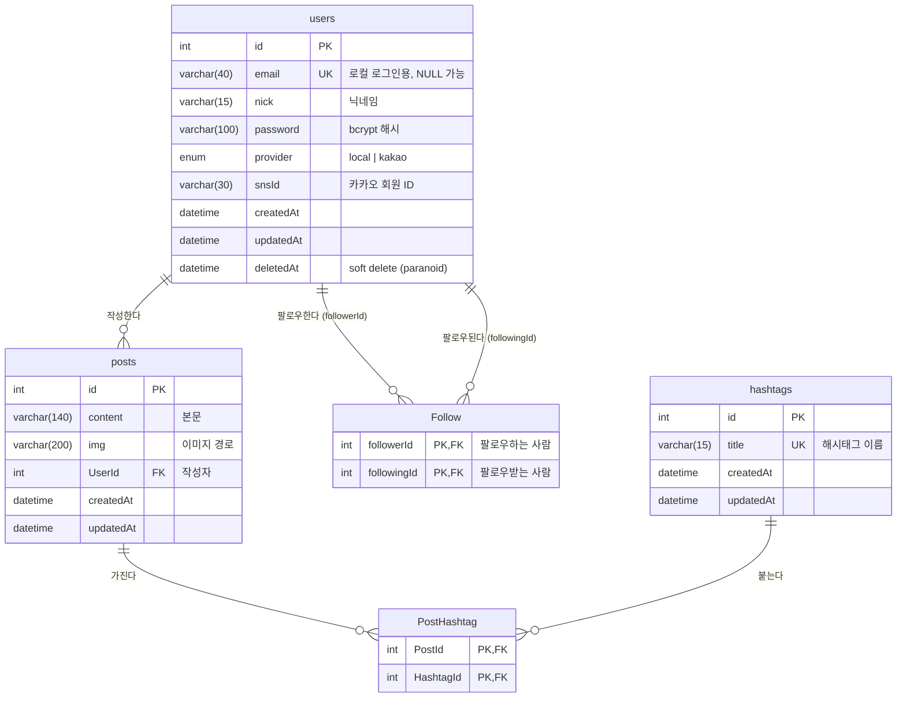

# mini-sns

Node.js와 Express로 만든 SNS 서비스입니다.

## 사용 기술

### Backend

| 기술                            | 용도                                                                         |
| ------------------------------- | ---------------------------------------------------------------------------- |
| Node.js / Express               | 웹 서버, 라우팅, 미들웨어 구성                                               |
| Sequelize / MySQL (mysql2)      | ORM으로 DB 모델링, `sequelize-cli`로 DB 생성                                 |
| Passport                        | 로그인 인증 (`passport-local` 이메일 로그인, `passport-kakao` 카카오 로그인) |
| bcrypt                          | 비밀번호 해시 암호화                                                         |
| express-session / cookie-parser | 세션과 쿠키로 로그인 상태 유지                                               |
| multer                          | 이미지 업로드 (디스크 저장, 5MB 제한)                                        |
| dotenv                          | 쿠키 비밀키, 카카오 키 등 환경 변수 관리                                     |
| morgan                          | 요청 로그 출력                                                               |
| nodemon                         | 코드 변경 시 서버 자동 재시작 (개발용)                                       |

### Frontend

| 기술         | 용도                                                 |
| ------------ | ---------------------------------------------------- |
| React.js     | 컴포넌트 기반 UI (기존 Nunjucks 템플릿을 대체)       |
| Vite         | React 개발 서버와 빌드                               |
| React Router | 메인, 프로필, 회원가입, 해시태그 페이지 라우팅       |
| axios        | 백엔드 API 호출 (`withCredentials`로 세션 쿠키 전송) |

## 주요 기능

- 회원가입, 로그인과 로그아웃 (이메일 로그인, 카카오 로그인)
- 게시글 작성, 이미지 업로드
- 해시태그로 게시글 검색
- 다른 사용자 팔로우
- 프로필 페이지 (팔로잉·팔로워 목록)

## DB 구조

| 관계           | 종류 | 설명                                                          |
| -------------- | ---- | ------------------------------------------------------------- |
| User → Post    | 1:N  | 사용자 한 명이 여러 게시글을 작성                             |
| Post ↔ Hashtag | N:M  | `PostHashtag` 중간 테이블로 연결                              |
| User ↔ User    | N:M  | `Follow` 중간 테이블로 자기 참조 (`Followers` / `Followings`) |
